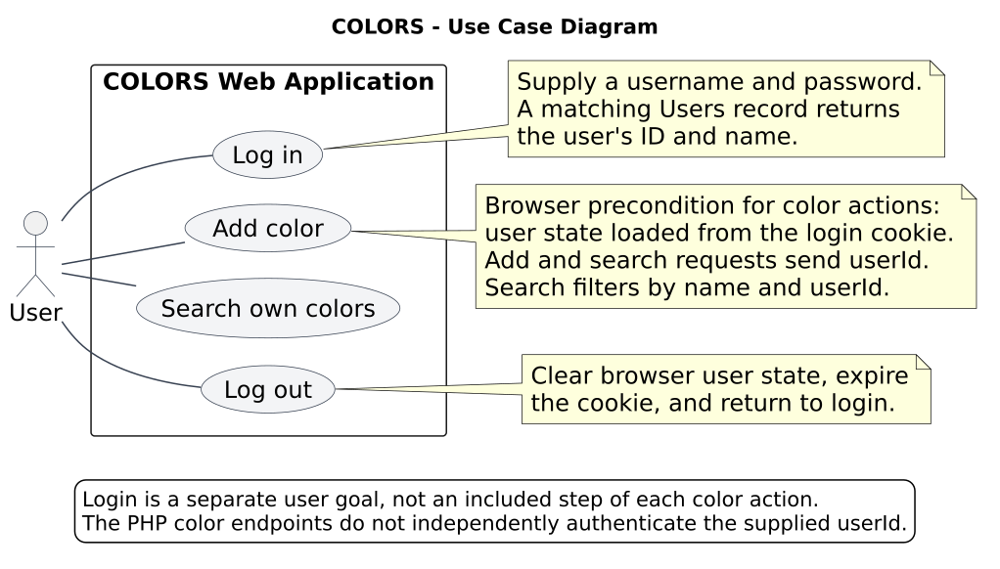
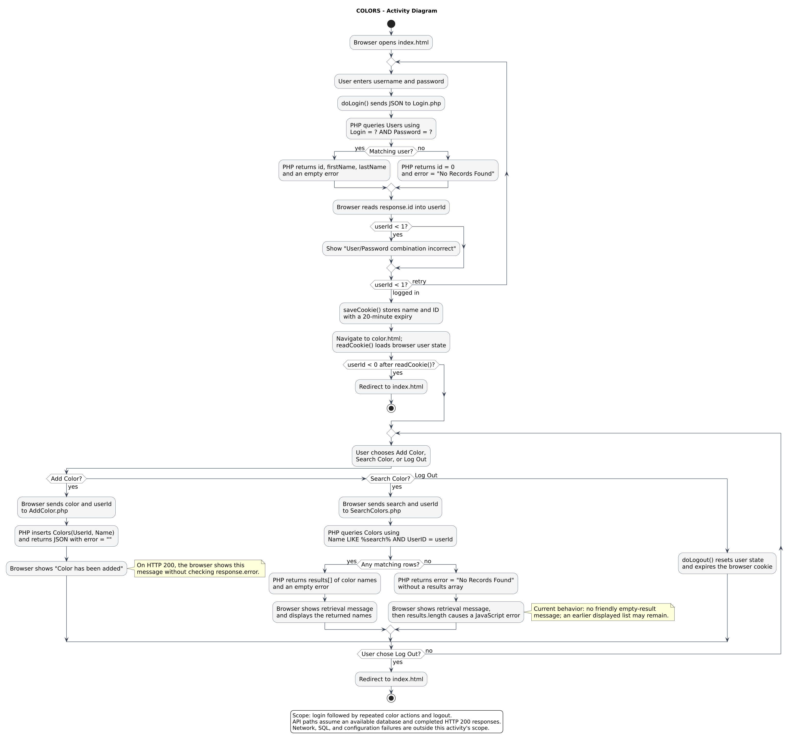
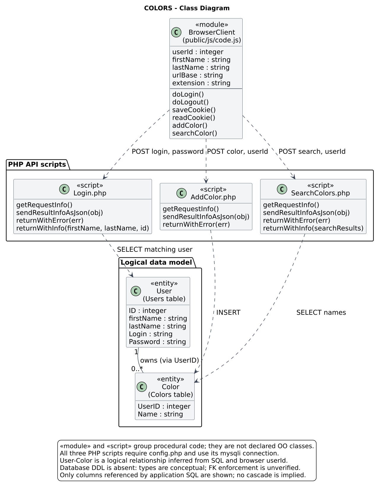

# COLORS UML Diagrams

These diagrams model the implementation in [brandenxo/colors-lamp](https://github.com/brandenxo/colors-lamp) at commit [`df2b328`](https://github.com/brandenxo/colors-lamp/commit/df2b32827c1dc5cfa71b5fc76b0540e167f7e4d7).

| Diagram | Editable source | Rendered diagram |
| --- | --- | --- |
| Use case | [usecase.puml](usecase.puml) | [PNG](usecase.png) / [SVG](usecase.svg) |
| Activity | [activity.puml](activity.puml) | [PNG](activity.png) / [SVG](activity.svg) |
| Class | [class.puml](class.puml) | [PNG](class.png) / [SVG](class.svg) |

## Use case diagram



The user can log in, add a color, search their colors, and log out. Login is a separate goal. Adding and searching require browser user state in the normal UI flow; neither action calls Login.php again, so there is no `<<include>>` relationship to login. The database is internal to the modeled application and is not an external user actor.

## Activity diagram



The activity follows login, cookie storage, loading the color page, repeated color actions, and logout. It includes rejected credentials and the actual no-match search behavior. It assumes an available database and completed HTTP 200 API responses; it does not attempt to model every configuration, transport, or SQL exception.

## Class diagram



The application uses procedural JavaScript and PHP. The class diagram therefore combines logical User and Color entities with stereotyped module/script classifiers for the implemented functions. These classifiers do not claim the code declares object-oriented classes.

One logical user can own zero or more colors, and each color is associated with one user through UserID. This relationship follows the application's use of the logged-in ID when inserting and searching colors. The repository does not contain database DDL, so physical constraints, field lengths, and SQL types cannot be verified. Types in this model are conceptual. The Color classifier includes only UserID and Name because those are the only Colors columns used by the committed SQL. No composition, cascading deletion, inheritance, or enforced foreign-key constraint is asserted.

## Implementation checks

| Model element | Source evidence |
| --- | --- |
| Login inputs and action | `public/index.html`, `public/js/code.js`: `doLogin()` |
| Login lookup | `api/Login.php`: `SELECT ID,firstName,lastName FROM Users WHERE Login=? AND Password =?` |
| Browser cookie and logout | `public/js/code.js`: `saveCookie()`, `readCookie()`, `doLogout()` |
| Color page actions | `public/color.html`: search, add, and logout buttons; `readCookie()` on page load |
| Add color | `api/AddColor.php`: `INSERT into Colors (UserId,Name) VALUES(?,?)` |
| Search own colors | `api/SearchColors.php`: `select Name from Colors where Name like ? and UserID=?` |
| Database connection | Each endpoint requires `config.php`; `api/config.example.php` demonstrates a `mysqli` connection |

## Behaviors preserved from the current code

- `addColor()` displays success on an HTTP 200 response without inspecting the JSON `error` field. The activity's insert path assumes SQL execution succeeds; it does not imply that the browser verifies persistence.
- A no-match search returns an error object without `results`. `searchColor()` first displays its retrieval message and then accesses `jsonObject.results.length`, causing an error inside the asynchronous callback. Its outer `try/catch` does not catch that later callback error, and an earlier color list may remain visible.
- `readCookie()` redirects only when `userId < 0`. It does not contact the server to validate a session. AddColor.php and SearchColors.php accept a caller-supplied userId without independent authentication.
- Logout is entirely in the browser; there is no logout API or server session in the committed implementation.
- Password hashing calls are commented out in `doLogin()`; the diagrams do not claim hashing is active.
- Registration, editing colors, and deleting colors are absent and are not modeled.
- The browser targets `/LAMPAPI/*.php` through its `urlBase`; the repository stores those handlers under `api/`. The diagrams use the handler filenames and do not infer Apache mappings from the folder layout.
- The deployed `config.php` and live database were not available for inspection. The example configuration can terminate on connection failure before an endpoint's own error branch executes.

## Regenerate

With Java and a PlantUML JAR installed, run from the repository root:

```bash
java -jar /path/to/plantuml.jar -tpng docs/uml/*.puml
java -jar /path/to/plantuml.jar -tsvg docs/uml/*.puml
```

The use case and class sources select PlantUML's Smetana layout engine, so Graphviz is not required. Sources and SVG renders were checked with PlantUML 1.2026.9. The included PNGs were exported from those SVGs using Inkscape at 144 DPI with a white background.
